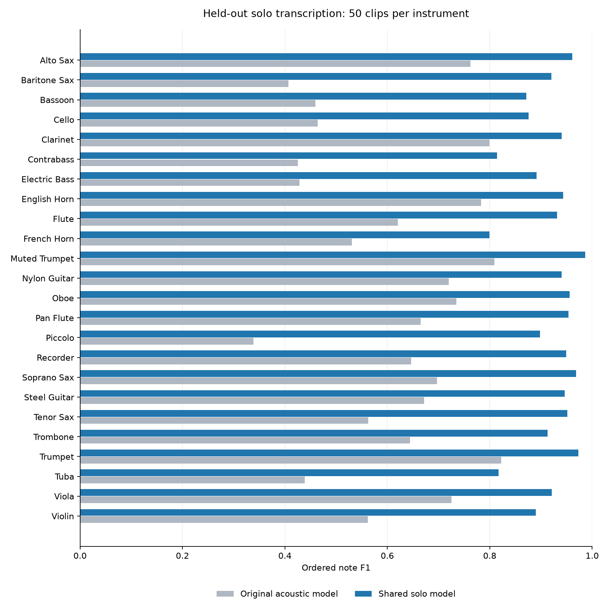

# Solo multi-instrument v1: measured results

One shared sounding-pitch model, MIDI 28–108. Checkpoint: `D:\stuff\Audio Evaluation\ALIGN\align-model\runs\solo-v1\solo-transcriber.pt`.

Dataset: 12,000 clips, 147,474 notes, 17.28 hours; 500 clips per instrument, split 400/50/50 by melody family. Two SoundFonts are represented in training and evaluation.

An independent training-only chromatic supplement adds 4,608 clips and 3.04 hours, covering every configured instrument pitch. A separate 288-clip register validation set uses independent seeds and rhythms. Total generated audio: 16,896 clips / 20.51 hours.

Selected variant: **calibrated**. Selected chromatic refinement plus a validation-tested +1.5 logit adjustment for sounding pitches below 50 or above 98, blank scale 0.5. On 1200 musical validation clips macro F1 is 0.92858 versus augmented 0.92973; register-validation macro improves from 0.81801 to 0.85023 and single-passage F1 from 0.92199 to 0.97015. Fast-passage F1 is slightly lower (0.93214 versus 0.93529), repeated-passage F1 improves (0.96765 versus 0.96552). Legacy clarinet F1 is 0.97804 versus original 0.98261. Larger calibration worsens precision; lower blank scaling worsens isolated-note F1. Saved checkpoint exactly reproduces every calibration-grid validation row. Accept the small musical/fast tradeoff for better pitch-range and isolated-note coverage; retain the original production defaults. Final test and real-take candidate results have not been used for this selection.

## Held-out synthetic transcription

Macro instrument F1: **0.613 → 0.917**. Paired 95% bootstrap interval for the improvement: +0.276 to +0.334.

Primary metric is one-to-one ordered pitch-note F1, counting repeated attacks separately. It measures transcription sequences; it does not directly measure final error-label correctness. The checkpoint was selected using validation data before opening this test split.

| Instrument | Original F1 | Solo F1 | Change |
|---|---:|---:|---:|
| alto sax | 0.762 | 0.961 | +0.198 |
| baritone sax | 0.407 | 0.920 | +0.513 |
| bassoon | 0.460 | 0.871 | +0.412 |
| cello | 0.464 | 0.876 | +0.412 |
| clarinet | 0.799 | 0.940 | +0.141 |
| contrabass | 0.425 | 0.814 | +0.389 |
| electric bass | 0.429 | 0.891 | +0.463 |
| english horn | 0.783 | 0.944 | +0.161 |
| flute | 0.621 | 0.931 | +0.311 |
| french horn | 0.531 | 0.800 | +0.269 |
| muted trumpet | 0.809 | 0.986 | +0.177 |
| nylon guitar | 0.720 | 0.941 | +0.221 |
| oboe | 0.735 | 0.956 | +0.221 |
| pan flute | 0.665 | 0.954 | +0.289 |
| piccolo | 0.339 | 0.898 | +0.559 |
| recorder | 0.646 | 0.949 | +0.302 |
| soprano sax | 0.697 | 0.968 | +0.271 |
| steel guitar | 0.672 | 0.946 | +0.274 |
| tenor sax | 0.563 | 0.951 | +0.388 |
| trombone | 0.644 | 0.913 | +0.269 |
| trumpet | 0.822 | 0.973 | +0.151 |
| tuba | 0.439 | 0.817 | +0.378 |
| viola | 0.725 | 0.921 | +0.196 |
| violin | 0.562 | 0.890 | +0.328 |

## Note types and timing

| Diagnostic | Original | Solo |
|---|---:|---:|
| All-note micro F1 | 0.622 | 0.919 |
| Onset/pitch F1 at 50 ms | 0.590 | 0.816 |
| Repeated-attack pair recall | 0.284 | 0.761 |
| Fast-note recall (<150 ms) | 0.481 | 0.767 |
| Single-note recall | 0.702 | 1.000 |
| Fast passage F1 | 0.598 | 0.856 |
| Repeated passage F1 | 0.620 | 0.964 |
| Single passage F1 | 0.641 | 1.000 |
| Mixed passage F1 | 0.648 | 0.981 |

Repeated-attack recall requires both members of a reference repeated pair to match distinct predictions. Passage F1 also penalizes extra notes; recall alone does not.

## Existing clarinet behavior

Legacy synthetic validation F1: **0.983 → 0.978** over 72 clips.

Real DataCreate regression: 25 manually labeled takes from 001–094. Labels from 095 onwards are excluded from gold. Sample 095 is retained only for visual inspection. The metric below matches affected reference-score note identities, without timestamp matching.

| Feedback type | v10 precision / recall / F1 | Solo precision / recall / F1 |
|---|---:|---:|
| wrong_note | 0.048 / 0.045 / 0.047 | 0.000 / 0.000 / 0.000 |
| missed_note | 0.125 / 0.125 / 0.125 | 0.000 / 0.000 / 0.000 |
| extra_note | 0.065 / 0.167 / 0.093 | 0.067 / 0.083 / 0.074 |
| repetition | 0.000 / 0.000 / 0.000 | 0.000 / 0.000 / 0.000 |

These real-feedback results do **not** support promoting the shared model over v10. The solo path has no independently calibrated multi-instrument presence verifier or error gates; it inherits clarinet-trained alignment/gating behavior and uses its learned CTC boundaries. No complete human note transcriptions are available for these recordings, so error-label F1 must not be interpreted as the acoustic transcription F1. Both the old and new systems perform poorly on this small, strict affected-note benchmark.

Inspection-only examples (no gold accuracy claims):

| Sample | Model | Transcribed/alignment notes | Suggested labels | Withheld extra / missed |
|---|---|---:|---:|---:|
| 007 | v10 | 259 | 8 | 3 / 3 |
| 007 | solo | 256 | 8 | 4 / 2 |
| 095 | v10 | 87 | 4 | 3 / 0 |
| 095 | solo | 92 | 2 | 5 / 0 |

Sample 095 still produces repetition labels. In 007, the solo path emits wrong-note and repetition suggestions, while its extra/missing candidates are withheld by inherited gates. All regression outputs are saved separately under `datacreate/`; live sample labels were not overwritten.

## Development comparisons

| Experiment | Musical validation macro F1 | Legacy clarinet F1 | Register diagnostic macro F1 |
|---|---:|---:|---:|
| baseline | 0.640 | 0.983 | 0.475 |
| transfer | 0.820 | 0.967 | — |
| augmented | 0.930 | 0.977 | 0.818 |
| chromatic | 0.926 | 0.978 | 0.846 |
| calibrated | 0.929 | 0.978 | 0.850 |

Register diagnostics deliberately exercise six low/mid/high pitches per instrument and bank, including pitches sparse or absent in the initial musical training distribution. They are development validation, not the final held-out musical test.

## Audio quality and scope

All 12,000 clips passed finite-sample, clipping, and per-note audibility checks. 91 clips needed an alternate sound bank because of missing or silent note regions. The chromatic supplement and register validation clips also passed full audio QA. 192 randomly sampled clips received an additional harmonic pitch check. Audition WAVs are in `audio-review/`. No perceptual listening was performed because this environment has no reliable listening tool.

The evaluation covers these 24 synthetic instrument programs. It does not establish universal accuracy on every real instrument, microphone, playing technique, or notes outside MIDI 28–108. Both test banks also appear in training. Only clarinet real recordings were available for paired feedback evaluation. Inherited error-confidence gates remain experimental outside clarinet. Note offsets are estimates from the next onset, not measured acoustic endings. v9/v10 defaults remain unchanged.

## Use

See `../../SOLO_MULTI_INSTRUMENT_V1.md` for commands and transposing-score handling. The opt-in DataCreate configuration is `DataCreate/config/solo.yaml`; legacy clarinet XML without transposition metadata requires `written_to_sounding: -2`.
