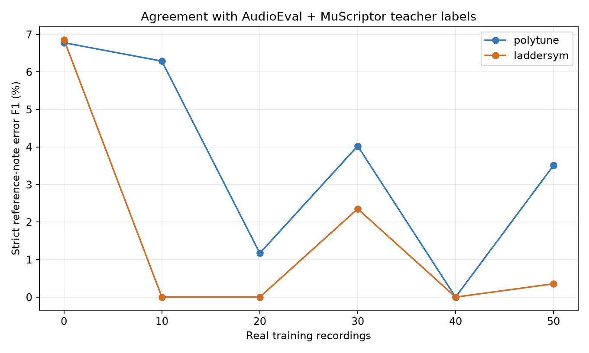

# Real DataCreate fine-tuning learning curve

Both author-pretrained models were independently fine-tuned on nested sets of 0, 10, 20, 30, 40, and 50 real recordings. Targets and evaluation references come from AudioEval v9 + MuScriptor medium. These results measure agreement with that teacher, not independently verified performance-error accuracy.

All 21 recordings 100–120 were decoded. The primary score uses 17 recordings with usable teacher annotations. Teacher abstentions (101, 105, 114, 117) are listed without treating their empty labels as clean gold. Their predictions remain available.

| Model | Training recordings | Strict precision | Strict recall | Strict F1 | Change vs 0 | Paired change 95% interval |
|---|---:|---:|---:|---:|---:|---:|
| polytune | 0 | 5.00% | 10.53% | 6.78% | +0.00% | +0.00% to +0.00% |
| polytune | 10 | 6.02% | 6.58% | 6.29% | -0.49% | -5.63% to +3.43% |
| polytune | 20 | 1.05% | 1.32% | 1.17% | -5.61% | -11.93% to -0.89% |
| polytune | 30 | 4.11% | 3.95% | 4.03% | -2.75% | -8.24% to +2.45% |
| polytune | 40 | 0.00% | 0.00% | 0.00% | -6.78% | -12.57% to -2.32% |
| polytune | 50 | 3.16% | 3.95% | 3.51% | -3.27% | -9.79% to +2.39% |
| laddersym | 0 | 5.47% | 9.21% | 6.86% | +0.00% | +0.00% to +0.00% |
| laddersym | 10 | 0.00% | 0.00% | 0.00% | -6.86% | -11.21% to -2.15% |
| laddersym | 20 | 0.00% | 0.00% | 0.00% | -6.86% | -11.21% to -2.15% |
| laddersym | 30 | 11.11% | 1.32% | 2.35% | -4.51% | -9.92% to +1.56% |
| laddersym | 40 | 0.00% | 0.00% | 0.00% | -6.86% | -11.21% to -2.15% |
| laddersym | 50 | 0.21% | 1.32% | 0.36% | -6.51% | -10.36% to -1.39% |

## Protocol

Each nonzero run starts from the same corresponding author checkpoint, with a fresh optimizer. All models receive 200 optimizer updates with accumulation of 4 windows, AdamW at peak learning rate 1e-5, and the original weighted classification loss. Sampling is uniform over recordings, then over assessed cached windows. All upstream trainable parameters are fine-tuned; fixed positional embeddings stay fixed. Training uses bf16 autocast; decoding uses float32, batch 1, and 1024 generated-token/prompt budgets. Final-step weights are evaluated; test scores never select epochs, thresholds, or hyperparameters.

The zero-data condition is the unchanged author checkpoint. Nested training IDs, checkpoint hashes, source hashes, and settings are frozen in `protocol.json`. The split has no shared source recordings or source pieces between training and test. One ordering and one training seed were used; bootstrap intervals describe test-recording variation only.

Native supervision uses Extra / Missing / Correct note sequences. Published wrong notes become Extra(heard pitch) + Missing(expected pitch); repetition notes become Extra. Correct targets require an aligned match. Windows overlapping withheld notes or unassessed score regions are excluded. Missing-note timestamps are teacher estimates. Samples with teacher abstention or unconvertible error labels are excluded from training before selecting the nested subsets.

MuScriptor can emit events beyond the recording duration. A uniform input-boundary correction discards notes starting after the waveform ends and clips offsets to the waveform. Changed cases were re-aligned; `teacher_bounds_audit.json` records this. No teacher decision was adjusted using either baseline output.

The primary metric requires the exact canonical affected-score-note location and error type, with one-to-one matching and repetition copy counts. GUI context padding is excluded. The existing baseline adapter converts native MIDI classes to error labels without teacher access. Unlocated and unclassified predictions remain false positives. The repository metric allowing half credit for a wrong type at the correct location is also saved in `results.json`; timestamps are not the primary score.

For each model, label type, and training size, counts and metrics are in `results.json`; every test prediction and its converted label JSON is retained. Teacher annotations for 100–120 were installed as agent labels with backups under `test_teacher_ui/`. Human label files and original checkpoints were preserved.

This experiment cannot establish that either fine-tuned model is more accurate than the teacher or a human annotator. Sparse or incorrect teacher labels, the three-class-to-error adapter, and only 17 usable test recordings limit interpretation.
