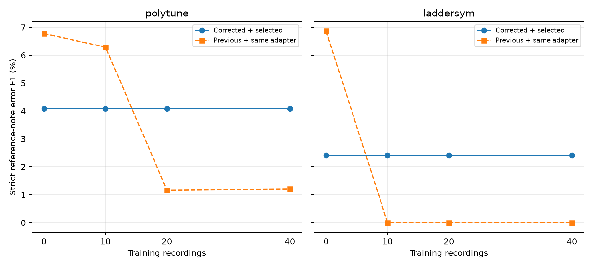

# Corrected real-data fine-tuning assessment

Six independent fine-tunes were completed: PolyTune and LadderSym with 10, 20, and 40 recordings. Each starts from the author checkpoint. Unchanged-checkpoint controls use the same corrected inputs and v2 adapter.

The primary metric requires reference-score note identity and error type. AudioEval v9 + MuScriptor medium provides pseudo-gold; this measures agreement with that teacher, not human-verified accuracy. The test set is the previously examined DataCreate 100–120 benchmark. All 21 recordings are inferred; 17 with 76 teacher labels are scored. Teacher abstentions 101, 105, 114, and 117 are excluded from scoring.

| Model | Training recordings | Selected update | Precision | Recall | Strict F1 | Change vs corrected control | Paired 95% interval |
|---|---:|---:|---:|---:|---:|---:|---:|
| polytune | 0 | 0 | 2.47% | 11.84% | 4.08% | +0.00% | +0.00% to +0.00% |
| polytune | 10 | 0 | 2.47% | 11.84% | 4.08% | +0.00% | +0.00% to +0.00% |
| polytune | 20 | 0 | 2.47% | 11.84% | 4.08% | +0.00% | +0.00% to +0.00% |
| polytune | 40 | 0 | 2.47% | 11.84% | 4.08% | +0.00% | +0.00% to +0.00% |
| laddersym | 0 | 0 | 1.74% | 3.95% | 2.42% | +0.00% | +0.00% to +0.00% |
| laddersym | 10 | 0 | 1.74% | 3.95% | 2.42% | +0.00% | +0.00% to +0.00% |
| laddersym | 20 | 0 | 1.74% | 3.95% | 2.42% | +0.00% | +0.00% to +0.00% |
| laddersym | 40 | 0 | 1.74% | 3.95% | 2.42% | +0.00% | +0.00% to +0.00% |

Update 0 means validation selected the unchanged model after actually training and evaluating all three candidate adapters. Such a row is a fallback, not an improvement due to training.

## Comparison with the previous experiment

| Model | Recordings | Previous published F1 | Previous outputs + v2 adapter F1 | Corrected selected F1 |
|---|---:|---:|---:|---:|
| polytune | 0 | 6.78% | 6.78% | 4.08% |
| polytune | 10 | 6.29% | 6.29% | 4.08% |
| polytune | 20 | 1.17% | 1.17% | 4.08% |
| polytune | 40 | 0.00% | 1.21% | 4.08% |
| laddersym | 0 | 6.86% | 6.86% | 2.42% |
| laddersym | 10 | 0.00% | 0.00% | 2.42% |
| laddersym | 20 | 0.00% | 0.00% | 2.42% |
| laddersym | 40 | 0.00% | 0.00% | 2.42% |

The middle column isolates the extra-note location adapter on unchanged old MIDI outputs. Differences from it also include reference retrieval, consistent input processing, performance-duration bounds, and (where selected) training. This is not a factorial causal ablation.

## What changed

- A label-free CQT/chroma path retrieves the corresponding 4.096-second reference passage for each 2.048-second performance window. It permits expensive forward/backward jumps. Reference audio and LadderSym MIDI prompts use the same crop. Pitch is not shifted to alter tempo.
- Upstream mel compression by a factor of two is preserved. Training and inference share one frontend; performance tensors match the old native training tensors within 1e-5.
- Decoder attention q/v projections receive rank-4 LoRA adapters (alpha 8, dropout 0.05). All author weights remain frozen. Training uses AdamW, peak LR 1e-4, 300 updates, accumulation 4, original weighted CE plus 0.2 KL regularization against the frozen model.
- Sampling alternates error-containing and clean assessed windows, balancing recordings within each stratum. With 1,200 sampled windows per trial, larger datasets receive fewer repetitions per recording; these are fixed-compute trials, not equal-epoch trials.
- Checkpoints at 0, 100, 200, and 300 updates are selected using full free-generation strict F1 on 12 disjoint validation recordings, with a capped-generation-rate guard and earlier-step tie-break. Test labels do not select checkpoints.
- The v2 adapter gives ordinary extras canonical neighboring score-note locations when supported by performed anchors. It refuses to bridge backward or copy-pass discontinuities. Other error conversions remain unchanged.

## Reference-context audit

| Subset | Audited note occurrences | Outside old context | Outside retrieved context |
|---|---:|---:|---:|
| 10 | 1278 | 56.89% | 10.80% |
| 20 | 3032 | 47.53% | 9.23% |
| 40 | 5234 | 50.08% | 8.92% |
| validation | 2415 | 41.16% | 7.25% |

This audit uses teacher-assigned correct-note occurrences only where XML and rendered MIDI have unambiguous identical pitch sequences. Ambiguous scores are excluded, and test labels are not used. Remaining mismatch includes repeated or acoustically ambiguous passages and windows crossing jumps.

## Error-type results

| Model | Recordings | Wrong F1 | Missed F1 | Extra F1 | Repetition F1 | Predicted / teacher labels | Capped windows |
|---|---:|---:|---:|---:|---:|---:|---:|
| polytune | 0 | 10.59% | 0.00% | 0.00% | 0.00% | 365 / 76 | 0 / 320 |
| polytune | 10 | 10.59% | 0.00% | 0.00% | 0.00% | 365 / 76 | 0 / 320 |
| polytune | 20 | 10.59% | 0.00% | 0.00% | 0.00% | 365 / 76 | 0 / 320 |
| polytune | 40 | 10.59% | 0.00% | 0.00% | 0.00% | 365 / 76 | 0 / 320 |
| laddersym | 0 | 4.69% | 0.00% | 0.00% | 0.00% | 172 / 76 | 0 / 320 |
| laddersym | 10 | 4.69% | 0.00% | 0.00% | 0.00% | 172 / 76 | 0 / 320 |
| laddersym | 20 | 4.69% | 0.00% | 0.00% | 0.00% | 172 / 76 | 0 / 320 |
| laddersym | 40 | 4.69% | 0.00% | 0.00% | 0.00% | 172 / 76 | 0 / 320 |

## Limitations and retained artifacts

One seed and one nested subset order were used. Paired bootstrap intervals (2,000 recording resamples) measure test-recording uncertainty, not training-seed variance. Validation recordings may share musical material with training; identical audio/XML hashes and available source filenames do not overlap, but older recordings have incomplete source metadata.

Wrong notes still require reconstructing paired native Extra+Missing events, and repetitions are reconstructed from Extra runs. Sparse/incomplete teacher labels, estimated missing-note times, ambiguous rendered score structure, and adapter range grouping can still prevent exact reference-note matches. No decoder heuristic suppresses adjacent identical notes.

Original checkpoints, old experiment files, human labels, and application defaults are preserved. This is an isolated experimental pipeline, not a promoted Studio default. `selection.json` records every validation candidate; `results.json` contains per-recording counts, per-type results, confidence intervals, and adapter-only comparisons. `predictions/` retains native MIDI, tokens, label JSON, and decode diagnostics. `training/` retains adapter weights, loss history, and frozen-weight verification.

## Inference runtime amendment

Before test generation, PolyTune decoding was changed to use its existing attention cache. Every generated token matched the original decoder on 287 saved validation windows, covering the unchanged model and its 100-update adapter, including capped outputs. Aggregate generation time on those recordings changed from 958.7s to 493.9s (1.94x). Training and all model-selection/scoring decisions remained frozen. See `runtime_amendment.json` and `cache_parity.json`.
