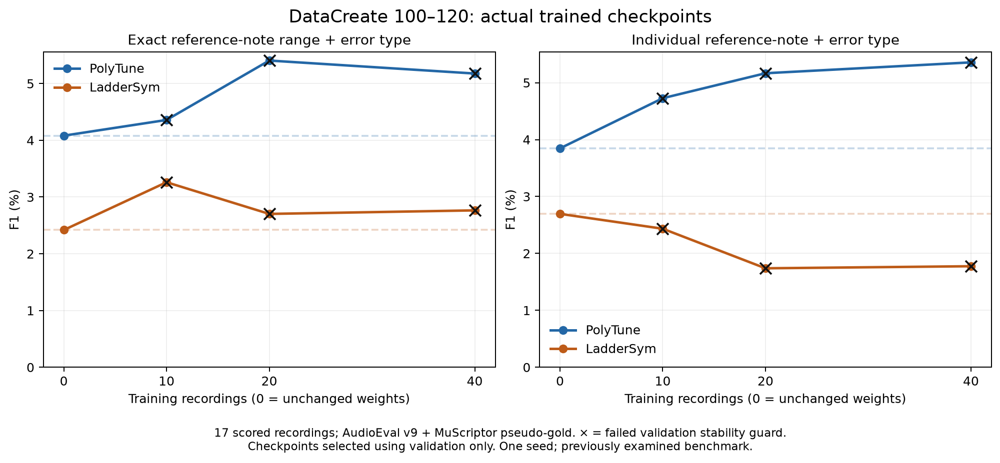

# Revised real-data fine-tuning assessment

All six requested fine-tunes and their test assessments are complete. The revised training avoids some of the previous fine-tunes' collapse, but it does **not establish a reliable improvement over the original models**. No experimental checkpoint was promoted to an application default.

## Reference-score error-label results

Every nonzero row below uses an actual trained checkpoint, selected using validation results only. The original stability-gated procedure selected the unchanged model for all six trials; those fallback scores are reported separately in RESULTS.md.

| Training recordings | PolyTune exact-label F1 | PolyTune individual-note/type F1 | LadderSym exact-label F1 | LadderSym individual-note/type F1 |
|---|---:|---:|---:|---:|
| 0, revised pipeline control | 4.08% | 3.85% | 2.42% | 2.70% |
| 10 | 4.36% | 4.73% | 3.26% | 2.43% |
| 20 | 5.41% | 5.17% | 2.70% | 1.74% |
| 40 | 5.18% | 5.36% | 2.76% | 1.78% |

The primary metric requires the exact affected reference-score note set and error type. The secondary metric scores individual note/type units, allowing different grouping of the same affected notes. Neither uses timestamp proximity as the matching standard. Repeated passages contribute one unit per reference note per extra copy; an insertion contributes one exact neighboring-note gap. The secondary metric has 197 teacher units, including 134 repetition units, versus 76 labels in the primary metric.

## What the comparisons establish

- All six strict-F1 point estimates exceed their revised control, but every paired 95% confidence interval crosses zero. The strongest strict increase is PolyTune with 20 recordings: **+1.32 percentage points**, interval **−1.44 to +4.31 points**. These intervals measure uncertainty across recordings, not training seeds.
- PolyTune's individual-note F1 rises in all three trials. LadderSym's falls in all three. All individual-note change intervals also cross zero.
- The revised input/output pipeline itself performs worse with unchanged weights: original-control strict F1 was **6.78% for PolyTune and 6.86% for LadderSym**, versus **4.08% and 2.42%** now. Rescoring old predictions with the new extra-note adapter leaves those original-control scores unchanged. The combined frontend, reference retrieval, and duration handling need further isolation; this experiment cannot assign the drop to one component.
- Relative to the previous fine-tunes, PolyTune improves at 20 and 40 recordings but worsens at 10. All three LadderSym fine-tunes improve from the previous zero strict F1. Nevertheless, none exceeds its original unchanged-model control.
- All six validation-selected trained candidates fail the validation output-stability guard. On the test set, only LadderSym with 10 recordings reaches the token limit, in 2 of 320 windows. Most test failures therefore do not require length-capped decoding.

## Remaining output problems

1. **Many unmatched predictions.** PolyTune with 20 recordings produces 331 labels for 76 teacher labels, with only 11 exact matches. LadderSym with 10 produces 292 labels with 6 exact matches. These are unmatched predictions under the teacher benchmark, not independently human-verified false positives.
2. **No missed-note or repetition recovery.** All six trained candidates have zero matches for both error types under both exact-label and individual-note scoring. Different range grouping alone does not explain this failure. Native Extra/Missing/Correct output still requires fragile conversion into wrong-note and repetition labels.
3. **Unlocated errors.** PolyTune's three trained trials leave 87, 81, and 82 labels without a score location; LadderSym leaves 57, 60, and 60. These cannot earn reference-note matching credit.
4. **A concrete unstable case.** On sample 106, LadderSym with 10 recordings emits 150 labels with 2 exact matches, compared with 22 labels and 2 matches from its revised control.

## Implemented changes and verification

The experiment adds label-free acoustic reference retrieval, shared training/inference preprocessing, matching audio/MIDI reference crops, balanced clean/error sampling, frozen-base rank-4 decoder LoRA adapters with KL regularization, validation checkpoint selection, and canonical locations for ordinary extra notes. All trials train for 300 updates; validation selects updates 100 or 200 for actual trained testing. Each model has 114,688 trainable adapter parameters.

The reference-context audit improves: outside-crop note occurrences fall from 50.08% to 8.92% on the auditable 40-recording training set. This is a preprocessing gain, not an end-to-end accuracy gain. PolyTune cached decoding is 1.94× faster on the verification recordings, with every generated token identical across 287 checked windows.

Eight unit/integration tests and both models' training/inference smoke checks passed. All six adapters changed while original weights stayed frozen. The completed audit passed 1,199 hash checks, verified all six actual trained test trials, and preserved original checkpoints, previous predictions, human labels, and teacher labels. Application defaults were not changed.

## Scope and limitations

All 21 DataCreate recordings 100–120 were inferred. Seventeen with 76 usable AudioEval v9 + MuScriptor medium labels were scored; teacher abstentions 101, 105, 114, and 117 were excluded. These are model-generated reference labels, not human ground truth. This is the previously examined benchmark, with one training seed and one nested subset ordering. The fixed update budget gives larger datasets fewer repetitions per recording. Incomplete source metadata prevents proving composition-level independence.

The next useful experiment is a validation-only ablation of the revised frontend/reference retrieval against the original inference path, together with inspection of native error-to-score conversion. The current results do not justify promoting any of these checkpoints.

## Detailed artifacts

- [Actual trained checkpoints, confidence intervals, and per-type results](TRAINED_RESULTS.md)
- [Individual-note/type assessment](NOTE_UNIT_RESULTS.md)
- [Original stability-gated selections and implementation protocol](RESULTS.md)
- [Every validation candidate and guarded-result interpretation](ANALYSIS.md)
- [Combined completion audit](completion_audit.json)
- [Machine-readable trained results](trained_results.json)
- [Native output diagnostics](output_diagnostics_both.json)
