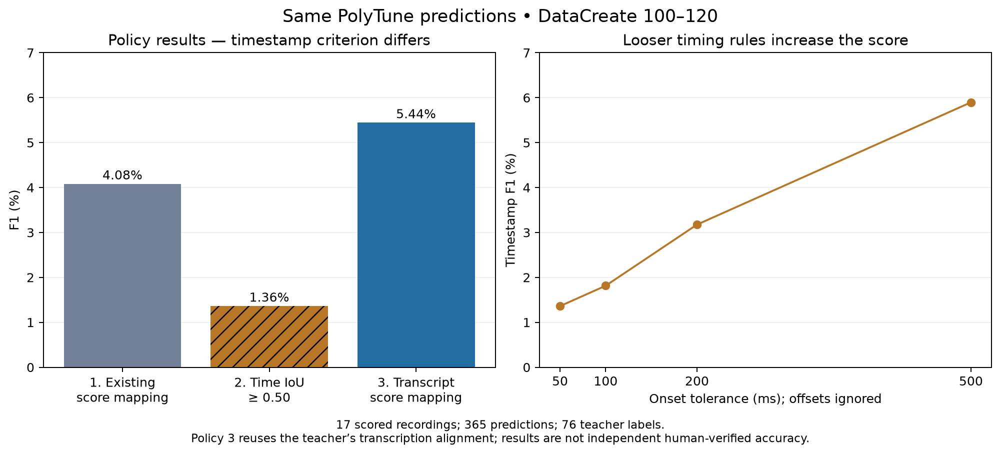

# PolyTune: three alignment and evaluation policies

**Policy 3 gives the highest reference-note F1 in this trial, but the gain is small, uncertain, and depends on a teacher-derived alignment. Policy 2 measures a different property and should be a complementary timing diagnostic.**

## Controlled comparison

All three policies use exactly the same saved PolyTune native predictions from the revised pipeline’s unchanged author checkpoint. There is no retraining, new decoding, checkpoint selection, label suppression, or error-type reassignment. The 21 DataCreate recordings 100–120 are processed; 17 with 76 usable AudioEval v9 + MuScriptor medium reference labels are scored. The four abstentions (101, 105, 114, 117) are excluded identically. These reference labels are pseudo-gold, not human ground truth.

Checkpoint SHA256: `9ed49dcdf864cb4957facf6d0ecfed944ea0484a5a69bccf1a7b0ed0c222f207`. The settings and implementation hashes were frozen in protocol.json before this policy scoring. The dataset and model outputs had already been examined in the prior experiment; this is a retrospective comparison, not an untouched holdout.

There are 365 predictions in every scored trial: 121 wrong-note, 6 missed-note, 238 extra-note, and **zero repetition labels**. Ground truth has 49 wrong-note, 9 missed-note, 5 extra-note, and 13 repetition labels. Alignment alone cannot recover a category the frozen label converter never emitted.

## Main results

| Policy | Matching standard | Exact matches / 76 | Precision | Recall | F1 | Recording-bootstrap F1 95% interval |
|---|---|---:|---:|---:|---:|---|
| 1. Status quo | Exact reference-note set and error type | 9 | 2.47% | 11.84% | 4.08% | 0.94%–7.93% |
| 2. Audio timestamps | Same error type and audio interval IoU ≥ 0.50 | 3 | 0.82% | 3.95% | 1.36% | 0.00%–2.71% |
| 3. Stored transcription lookup | Exact reference-note set and error type | 12 | 3.29% | 15.79% | 5.44% | 1.54%–9.96% |

Policy 3 versus policy 1: **+1.36 percentage points**, paired 95% interval **-0.50 to +3.15 points**. The interval includes no improvement. Two thousand paired recording bootstrap draws were used; these do not measure uncertainty from model seeds or teacher-label errors.

Policies 1 and 3 can be directly compared on the same score-note metric. Policy 2 has a different matching target: its F1 is not interchangeable with the other two and a larger timestamp tolerance must not be presented as a model improvement.

| Reference-note diagnostic | Policy 1 | Policy 3 |
|---|---:|---:|
| Individual note/type F1, reducing label-grouping effects | 3.85% | 4.22% |
| Unlocated predicted labels | 58 | 52 |

## What each policy actually does

### Policy 1: existing adapter

The existing adapter pairs native Extra/Missing events into wrong notes, detects repetition candidates, and assigns score locations with its monotonic pitch-sequence alignment and repeat heuristics. This trial uses its v2 extra-note neighbor locations. Display padding is removed before comparison. The original 9 matches and 4.08% F1 were reproduced exactly from the native MIDI.

**Pros:** produces actionable reference-note locations, needs no separate performance transcriber, and is insensitive to minor audio-boundary errors. **Cons:** an erroneous or repetitive native pitch sequence can misplace many labels; the sequence path is primarily monotonic; separate span and placement rules can disagree; canonical note identity alone can confuse repeated occurrences.

### Policy 2: compare in performance-audio time

All 76 teacher labels already contain performance-audio start/end times. The trial exports these directly instead of converting score tempo into audio time or inventing new timing estimates. The 9 missed-note intervals are existing teacher estimates; a genuinely omitted note has no observable acoustic onset. Repeated labels retain their recorded occurrence intervals.

Primary matching requires equal error types and temporal intersection-over-union (IoU) of at least 0.50. IoU is overlap duration divided by union duration. Matching is exclusive, maximizing the number of valid matches before similarity. Repetition copy counts must also agree. Duplicate predictions cannot match the same reference twice.

**Pros:** bypasses predicted-note-to-score alignment, identifies when the error happened, and distinguishes repeated occurrences. **Cons:** sensitive to onset/duration errors and interval grouping, depends on uncertain timing for missed notes, can match a nearby wrong score note at loose tolerances, and does not verify that UI feedback highlights the right reference note.

### Policy 3: use stored MuScriptor transcription and score alignment

An allowlisted lookup contains only note onset/offset, pitch, score-span indices, and reference rhythm. Teacher error labels, relationship categories, repetition decisions, and unassessed-label masks are excluded. A separate projection process denies reads of the original teacher/bundle files.

Wrong-note labels select the transcript event with greatest temporal IoU among candidates overlapping at least half the shorter interval. Missing-note lookup also includes virtual score-gap intervals interpolated between consecutive forward-aligned anchors, without extrapolation beyond them. Extras use surrounding aligned transcript notes to locate the insertion gap, refusing backward boundaries. Repetition ranges use the union of covered score notes and preserve the predicted copy count. Error type, audio interval, and label count never change; unsupported locations remain unmatched predictions.

**Pros:** retains score-note feedback, uses a fuller performance transcription for location, can follow repeated passages, and reduces dependence on PolyTune’s faulty error-note sequence. **Cons:** requires another transcriber/aligner, inherits its mistakes and gaps, must estimate missing-note locations, and can map tiny predicted fragments onto entire score notes. Crucially, the lookup and pseudo-gold come from the same AudioEval+MuScriptor system. Not reading labels prevents direct copying, but does not remove that shared-source dependence; this is a hybrid pipeline, not independent proof that PolyTune improved.

## Timestamp sensitivity, all declared before scoring

| Timestamp rule | Matches | F1 |
|---|---:|---:|
| IoU ≥ 0.25 | 7 | 3.17% |
| IoU ≥ 0.5 | 3 | 1.36% |
| IoU ≥ 0.75 | 0 | 0.00% |
| Onset difference ≤ 50 ms; offset ignored | 3 | 1.36% |
| Onset difference ≤ 100 ms; offset ignored | 4 | 1.81% |
| Onset difference ≤ 200 ms; offset ignored | 7 | 3.17% |
| Onset difference ≤ 500 ms; offset ignored | 13 | 5.90% |

The onset-only 500 ms score rises to 5.90%, but can span several fast notes. It is a looser evaluation criterion, not evidence of better reference-note identification.

## Per-error-type results

| Type | Teacher labels | Predicted labels | Policy 1 matches | Policy 2 matches | Policy 3 matches |
|---|---:|---:|---:|---:|---:|
| wrong_note | 49 | 121 | 9 | 3 | 11 |
| missed_note | 9 | 6 | 0 | 0 | 0 |
| extra_note | 5 | 238 | 0 | 0 | 1 |
| repetition | 13 | 0 | 0 | 0 | 0 |

## Concrete disagreements and occurrence audit

- **103, polytune_0003:** the old adapter assigns notes [2, 3]. The transcript lookup assigns note [2], matching the reference. Its predicted interval 5.0909–6.1409 s overlaps the reference 5.13–5.66 s at IoU ≈ 0.505, so timestamp matching also succeeds.
- **106, polytune_0000:** the old adapter credits note [0] for a prediction at 0.00–0.45 s, but the reference error is at 2.11–2.58 s. The lookup leaves the prediction unlocated because it precedes the stored transcript’s first note.
- **106, polytune_0017:** the lookup maps a prediction at 28.4295–28.6705 s onto note [9], which earns canonical-note credit against the reference label at 12.87–12.99 s. The same note occurs in repeated material. This shows that score-note identity without occurrence identity can grant credit to a different performance pass.
- **106, polytune_0006:** a 9.1 ms predicted wrong-note fragment maps to reference note [5]. It earns reference-note credit, but its temporal IoU is only about 0.009. Policy 3 is deliberately tolerant of duration and therefore does not establish accurate note boundaries.
- **104, polytune_0008:** the lookup cannot locate the relevant transcript event and loses a previous score-note match. The helper transcription does not resolve every case.

After the primary trials, an additional diagnostic re-matched predictions while requiring both exact score identity/type and **positive temporal overlap**. This is explicitly post-hoc, with no minimum IoU, and does not replace or tune the three trial metrics. It uses a new exclusive assignment, avoiding arbitrary duplicate-match tie choices.

| Diagnostic | Policy 1 | Policy 3 |
|---|---:|---:|
| Score identity + any temporal overlap: matches | 0 | 8 |
| Score identity + any temporal overlap: F1 | 0.00% | 3.63% |
| Credited predictions shorter than 20 ms | 0 | 2 |

## Runtime, checks, and recommendation

All predictions were reused. Re-running the current adapter over 21 recordings took 1.073 s; projecting through the already cached transcription took 0.045 s. Timestamp scoring over the 17 scored recordings took 0.0027 s. These small CPU measurements exclude PolyTune inference, MuScriptor transcription, and ALIGN alignment. They are not end-to-end speed comparisons.

Nine targeted tests passed, covering matching exclusivity, duplicate penalties, adjacent/repeated notes, unmapped silence, missing-note interpolation, insertion boundaries, and preservation of error types/counts. The audit verified identical model/prediction inputs, unchanged original artifacts, 42 sanitized inputs, and 129 protected files. No application defaults or live labels were changed.

**Recommendation:** retain reference-note/type accuracy as the primary product metric. Policy 3 is the more promising location adapter when the stored transcription is available, but validate it against independently human-checked labels before adopting it. Keep policy 1 as the reproducible standalone baseline and policy 2 as a timing/occurrence diagnostic. For repeated passages, extend reference labels with an explicit performance-occurrence or copy-pass identity; for missed notes, represent a bounded gap between observed neighbors and mark timing uncertainty. Neither a higher timestamp tolerance nor this small hybrid gain solves the model’s excessive extra-note predictions or absent repetition labels.

## Reproducibility

Run `test_policies.py`, then `assess.py run` to reproduce the frozen comparison; `assess.py prepare` is only for the initial freeze and refuses to overwrite it. `report.py` produces this report and the post-hoc diagnostic. See protocol.json, results.json, mapping_changes.json, occurrence_diagnostic.json, projected/, timestamp_gold/, and audit.json for complete evidence.
